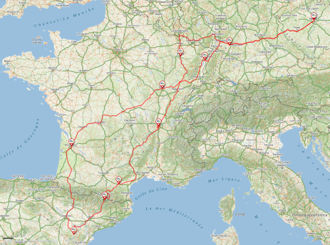
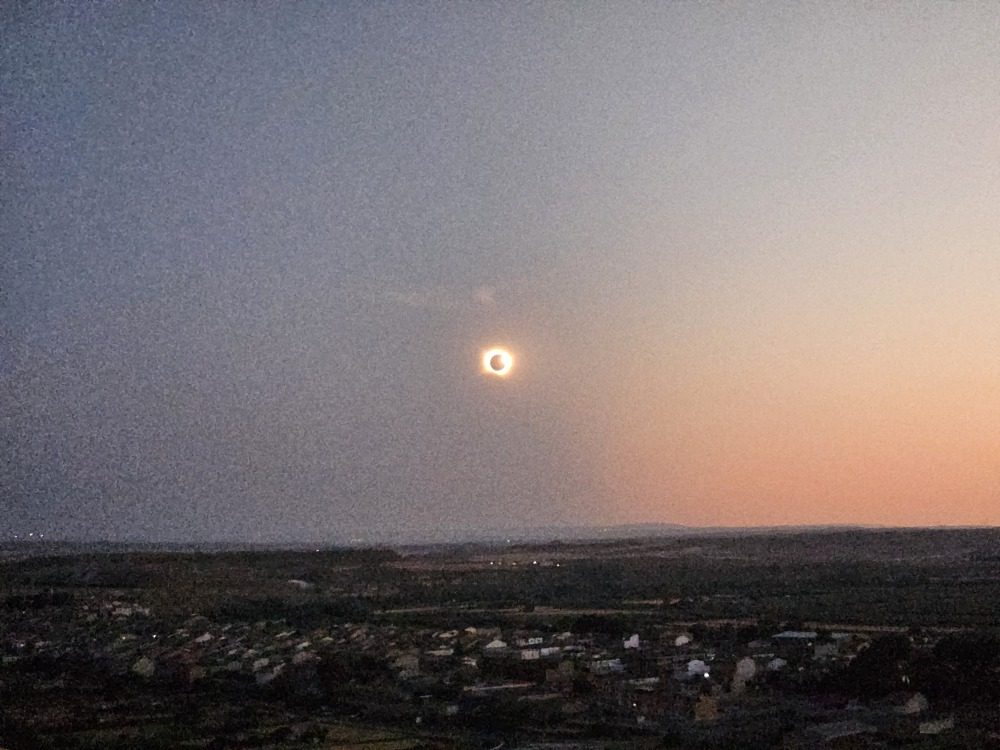

* Blank invisible line
{:toc}

## Selection and preparations

This had started almost a year in advance when some of my friend began to plan
(and book) the travel to Spain for the eclipse.
I was unamused by the kids because I already saw the eclipse in 1999 in
Czechia, whole 96% B-) and I had been to [Spain]() recently. Resolved.

Fast forward to 2026 and another group of friends asked me whether I'd join
their road trip to Spain.
I presented them with my resolution but they countered with an [XKCD
strip](https://xkcd.com/2914/).
That curve and the prospect of seeing lots in France convinced me.

I left the astronomical preparations to astronomers and only focused places
desirable to visit along the path (which was defined by booked accomodations
for each day).

{:.thumbnail}

## Diary

### Day 00 (2026-08-07)

  * **sleeping:** Heilbronn, Monteurhaus
  * Leaving after lunch, traffic in Prague is still OK, ride on highway,
    driving duties around 2 hours.
  * No border control to Germany (how unusual despite the Schengen area).
  * **Heilbronn** (out of limits)
    * industrial city (carbon [power
      plant](https://de.wikipedia.org/wiki/Kraftwerk_Heilbronn), Fujitsu
      skyscraper (actually Neckarsulm))
    * historical (rebuilt) center around the river, possibly a port
    * vineyards in the north
    * dinner at fine restaurant, evening trip to Warteberg

### Day 01 (2026-08-08)

  * **sleeping:** Nancy

  * cool (not hot) morning, direct ride to Lux
  * **Luxembourg** (out of limits)
    * cheap gasoline, free public transport
    * surprisingly picturesque town, like Český Krumlov
    * design/architecture visible in everything (train station, public transport)
    * partial trams (battery powered)
    * sun and temperature were bearable
  * **Nancy** (Nanciaco?)
    * impressive square and Hôtel de Ville
    * videomapping

### Day 02 (2026-08-09)

  * **sleeping:** Lyon
  * bad sleep (neck/headache), compensated with morning run along the river
  * headachy drive to Besançon, rain shower before arrival
  * **Besançon** (Vesontio)
    * town has compact center with weird basilica,
    * the pinnacle is the Citadela fortress
    * other: (small) Roman theater, birthhouse of Victor Hugo
    * lunch and a dose of coffee fixed the headache
  * afternoon ride with hundreds of roundabouts to Lyon
  * a stop in Saline Royal, not much to see for free
  * **Lyon** (Lugdunum)
    * multiple cathedrals, Roman excavations,
    * evening walk down from basilica, crossing two rivers, Saône and Rhône

### Day 03 (2026-08-10)

  * **sleeping:** Carcassone
  * Roman aqueduct, then climb to Massif Central
  * swimming in volcanic [lake](https://en.wikipedia.org/wiki/Lac_du_Bouchet)
  * (free) highway after curved descent, followed by one more ascent above Millau
  * Millau view point was best experience
  * **Carcassonne** (Carcaso)
    * (late) evening walk Carcassonne
    * it's a UNESCO tourist attractor, so very crowded even very late
    * fortress is now full of restaurants (and fake crusaders)

### Day 04 (2026-08-11)

  * **sleeping:** Andorra la Vella
  * quick ride to [fountain of (naturally) variable flow](https://fr.wikipedia.org/wiki/Fontaine_intermittente_de_Fontestorbes),
    * hitech (water supply)/lowtech (hole) toilet nearby

  * [castle Montseguir](https://en.wikipedia.org/wiki/Ch%C3%A2teau_de_Monts%C3%A9gur)
    * pinnacle of the day
    * prominent hill, great outlooks, mysterious history
  * further ride, quick coffee while refueling in France
  * climb to Pas de la Casa: awful place (shops)
  * Port d'Envalira 
    * highest point, weather change, start of rain
    * descent to Vella
  * **Andorra la Vella** (unreachable)
    * modern compact city on the steeps of the valley
    * clean, rich, lot of Spaniards
    * cheap gasoline (again)
    * (I shouldn't have had 3rd coffee für dinner, could not sleep)

### Day 05 (2026-08-12)

  * **sleeping:** Alcorisa
  * morning run in Andorra, great, it's like a village few vertical meters up
    from the main road
  * La Seu d'Urgel (Sedes Urgelli)
    * Olympic Channel
    * seat of Andorran co-prince
  * a swimming stop near Oliana dam
    * high waves but low water (level)
  * lunch in 39°C of Torrente de Cinca, menu for 15€ with locals and AC
  * Monastir de Ruenda 
    * impressive, sumptuous
    * cool place to wait for the eclipse (in the hot weather)
    * 16m water wheel (Ruenda == wheel)
  * the **Eclipse**
    * an hour till (partial) start and parking place is full
    * meeting with friends from Barcelona
    * threatening clouds in the east
    * up to 40°C
    * totality
      * awaiting the full eclipse, total eclipse is phase change
      * surprisingly low brightness but not as low as night :-)
  * evening ride to Alcorisa, roads empty, late dinner (11 PM, still open)

{:.thumbnail .photo}

*Photo* End of the total eclipse (notice the [pearl](https://en.wikipedia.org/wiki/Baily%27s_beads) and edge of conic shadow)

### Day 06 (2026-08-13)

  * **sleeping:** Bordeaux
  * dessert-like or wild-west-like Spanish landscape
  * Canfranc
    * Brenner vibes
    * former railway station on international tunnel, the tunnel serves for
      underground cosmic detectors these days
    * apparently a popular hiking spot
  * descent to Bordeaux, along some forest fires, queues on arrival, late arrival ~20.30
  * evening program: an Italian restaurant, kids serving, kids celebrating
  * **Bordeaux** (Burdigala)
    * night walk through Bordeaux, utilizing _pass soir_ till maximum
    * [estetic tram power](https://en.wikipedia.org/wiki/Alstom_APS)
    * submarine docks

### Day 07 (2026-08-14)

  * **sleeping:** Dijon
  * pure ride to cover the distance, only stop for lunch in Boucherie with weird bell-ringing mantra
  * F1 hotel very minimalistic, positive is AC
  * **Dijon** (Divio)
    *  it's smaller but it has also many architected sights, mainly Place de Liberation

### Day 08 (2026-08-15)

  * **sleeping:** Strasbourg
  * **Colmar** (N/A)
    * the town is like a smaller Strasbourg
    * birthplace of [Bartholdi](https://en.wikipedia.org/wiki/Statue_of_Liberty)
  * castle of Königsberg
  * **Strasbourg** (Argentoratum)
    * the city is little bit more dirty
    * public transport is free, including parking at P+R (due to environmental emergency)

### Day 09 (2026-08-16)

  * **sleeping:** Prague

## People and culture

  * popular videomapping in France (Nancy, Strasbourg)
  * a flyer (paraglider) above Millau
  * turquoise guard (pensioner) of French tourist club or similar
  * Barcelonian friends at the eclipse mirador
  * Alcirosa -- evening (12 PM) concert at a square, kids around
  * proportion of people of African origin is higher in France (than in Czechia)
  * anectodal: (partially) shave out haircuts on women

### Food

  *  crème brûlée -- curious method of preparation
  * "Indurian" -- dish (based on pork) offered in Pas de la Casa
  * TODO

## Nature

  * rivers
    * Rhein (Speyer)
      * Mosele (~Nancy)
    * Rhône (Lyon)
      * Saône (Lyon)
    * Loire ((Viaduc du Lignon), Le Puy-en-Velay)
    * Ebro (Mequinensa)
      * Valira (Andorra la Vella)
    * Garonne (Bordeaux)

  * passes
    * TODO

  * up to 40°C outside, thanks for the (preparatory) heat wave in Czechia
  * forest fires (visible from distance as smoke, closed roads in vicinity, depends on wind)
  * animals
    * mainly carcasses on road
  * [the eclipse](https://en.wikipedia.org/wiki/Solar_eclipse_of_August_12,_2026)

## Technologies and man-made sites

  * Roman aqueduct with level bricks and surface cobblestones
  * Safran Landing Systems (Pyrenees--Bordeaux)
  * Canfranc railway station and tunnel
  * castle of Königsberg
  * Canal du Midi

## Lessons learnt

- both cycling and driving is about time, not speed (car speed ~ 4x velo speed on average)
  * backpain from car vs arsepain from bicycle
  - accommodation not so different from cycling trip (B&B, F1 near cities/roads) 
- AC in rooms overnight is convenient but draft sucks, fans are also OK
- it has helped me to have some lenience to drivers
- cabin fever possibility after several days in car (the larger the group, the better)

### Driving

  * France: no highways means lots of roundabouts
  * Spain
    * six points for smoking in cars (because of fires, not the driving)

### Equipment

  * day and night backpack + food bag

### Close misses

  * submarine docks in Bordeaux
  * TODO

## Misc

  * daily routine
    * evening quick planning of the next day
  * _pass soir_ tickets for public transport, useful for the road-tripping tourism
  * Czechia is really small country, cf many central cities in France
  * I'm continuously surprised how my friends use LLM chats for everything
  * the travel was mostly in former Roman empire
  * how come they have such a good urban layout without assanation?

## Statistics

| Date       | Distance (km) | Highest point (m) | Lowest point (m) |
|------------|---------:|-----------:|----------:|
| 2026-08-07 | 480.0    |  615	     | 170       |
| 2026-08-08 | 410.5    |  420	     | 100       |
| 2026-08-09 | 434.3    |  590	     | 169       |
| 2026-08-10 | 541.3    |  1310	     | **10**    |
| 2026-08-11 | 210.7    |  **2400**	 | 110       |
| 2026-08-12 | 339.1    |  1054	     | 70        |
| 2026-08-13 | 573.8    |  1210	     | **10**    |
| 2026-08-14 | 628.4    |  550	     | **10**    |
| 2026-08-15 | 354.0    |  710	     | 140       |
| 2026-08-16 | 640.7    |  615	     | 110       |
|------------|----------|-----------|------------|
| sum        | 4612.8   |           |            |
| mean       | 461.3    |           |            |

(Credits to L for the map & stats)

- TODO add kg CO2 stats

